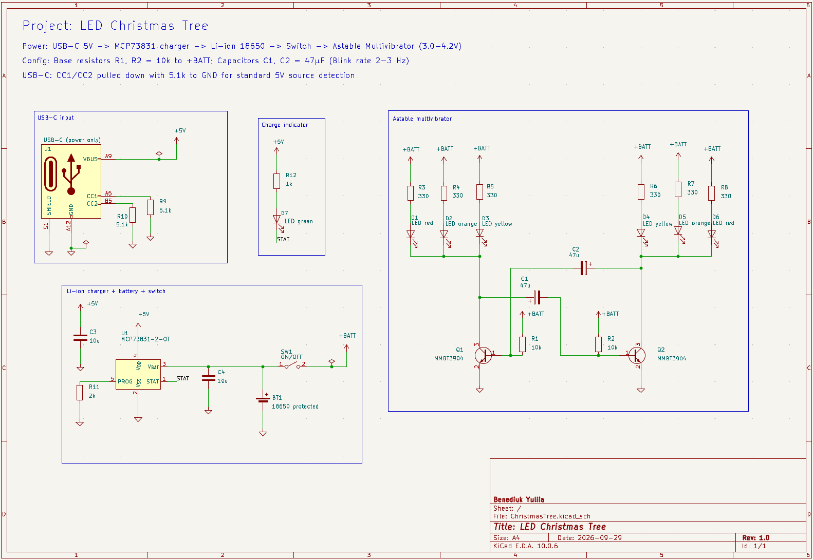
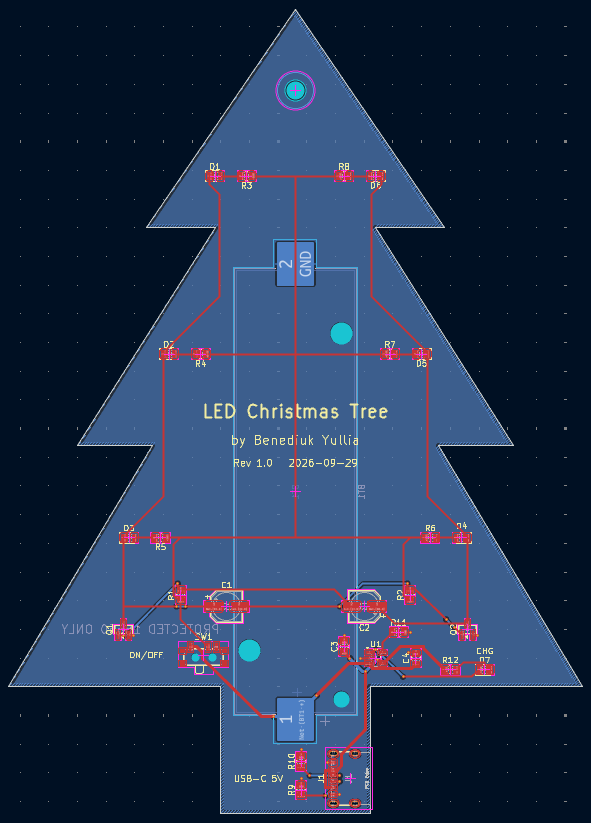
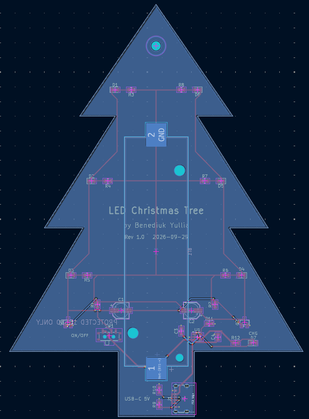
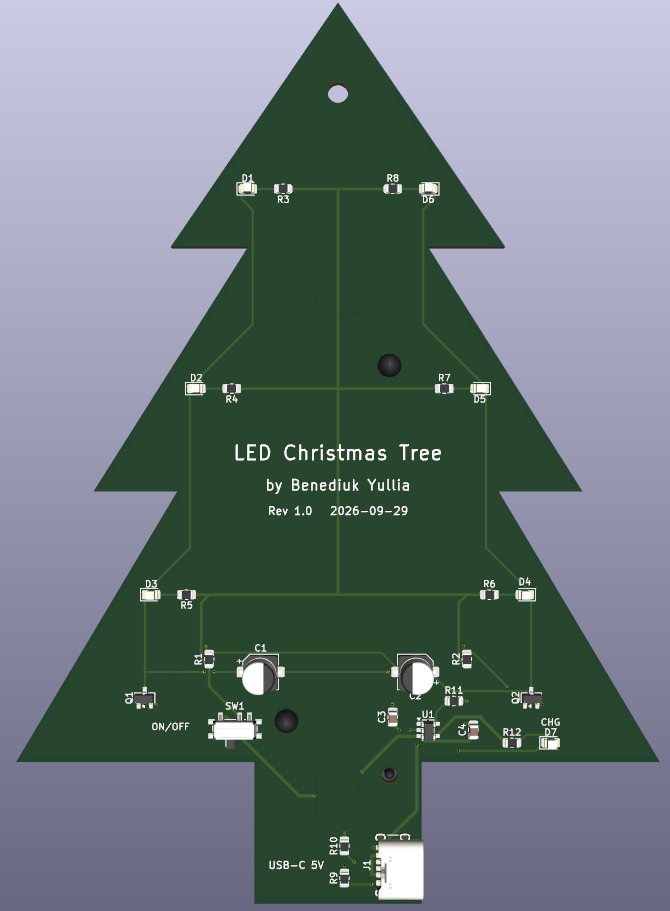
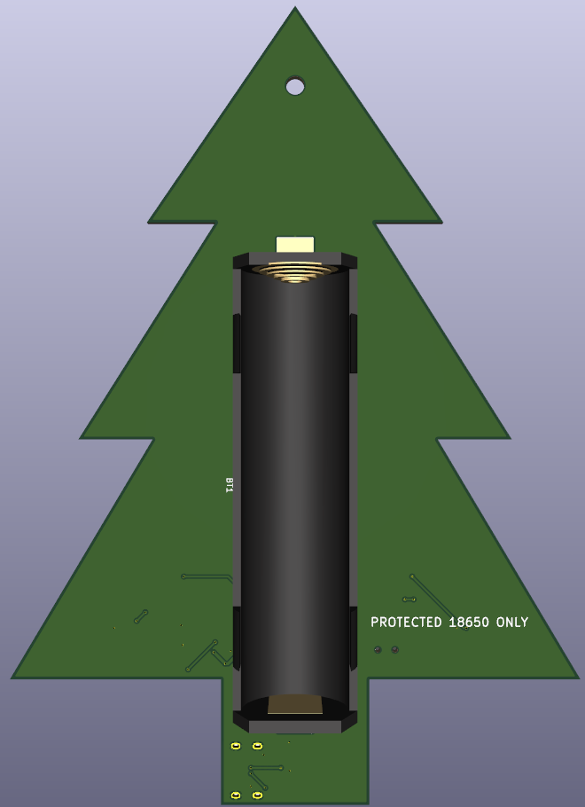
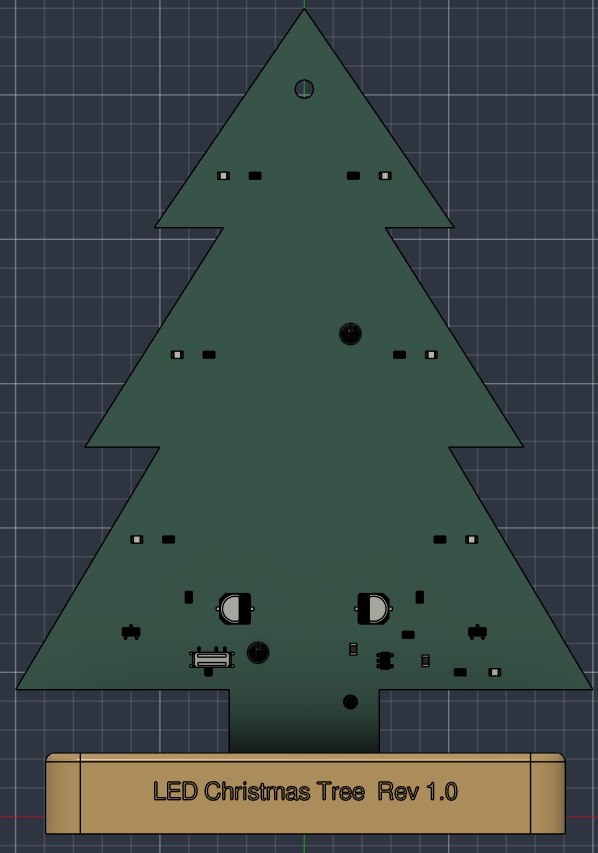
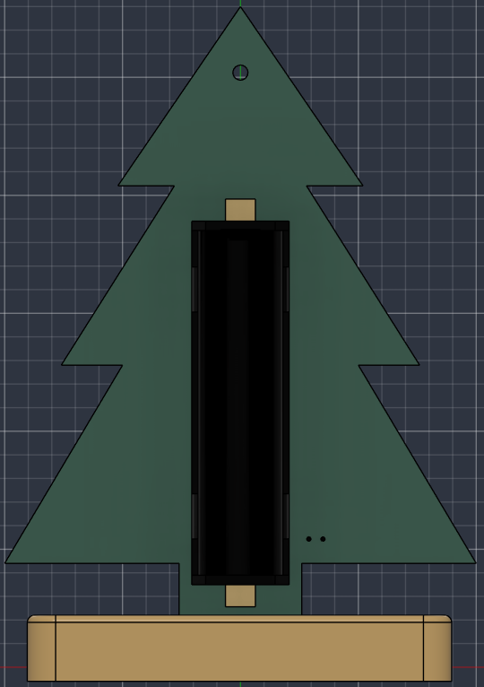
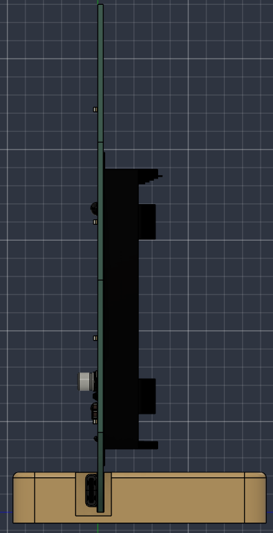
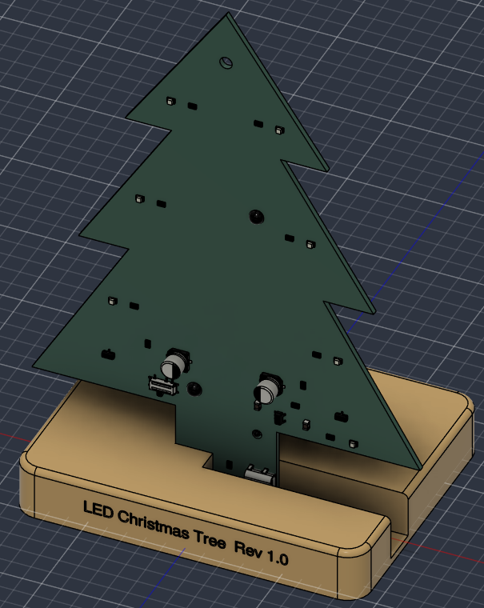

# LED Christmas Tree

A Christmas tree-shaped LED board powered by USB-C and a rechargeable Li-ion 18650 battery, where two groups of colored LEDs blink alternately using a transistor astable multivibrator.

**Author:** Benediuk Yullia. **Revision:** 1.0. **Tools:** KiCad 10 and Fusion.

## How it works

Power comes from a USB-C charger at 5 V. A charger chip (MCP73831) takes this voltage and charges a Li-ion 18650 cell. The cell is connected to the output of the charger, and through an ON/OFF switch it supplies the blinking circuit. This means the tree runs from the battery, and when the cable is plugged in, the battery is charged at the same time and the tree keeps blinking.

The blinking is made by an astable multivibrator, an analog circuit without a microcontroller and without any code. It has two transistors, and each transistor switches one group of three LEDs. The collector of each transistor is connected through a capacitor to the base of the other one. Because of this, when one transistor turns on, it turns the other one off, then the capacitors slowly recharge through the base resistors, and after a fraction of a second the transistors swap roles. So the left group and the right group of LEDs light up one after another, about 2 to 3 times per second.

## Schematic

The schematic is divided into blocks:

- **USB-C input.** The connector J1 gives 5 V. Two 5.1 kΩ resistors from the CC1 and CC2 pins to ground tell the charger that a device is connected, so it provides 5 V.
- **Charger.** The MCP73831 chip charges the cell with about 500 mA, the current is set by the 2 kΩ resistor on its PROG pin. Two 10 µF capacitors smooth the input and the output.
- **Charge indicator.** A green LED with a 1 kΩ resistor lights up while the battery is charging.
- **Battery and switch.** One 18650 cell with a built-in protection board and a slide switch that turns the tree on and off. The battery can be charged with the switch off.
- **Multivibrator.** Two MMBT3904 transistors, two 47 µF capacitors connected crosswise, and two 10 kΩ base resistors.
- **LED groups.** Six LEDs, three on each transistor: red, orange and yellow. Every LED has its own 330 Ω resistor, which limits its current to about 4.5 mA.

## PCB

| Front | Back |
|---|---|
|  |  |

| Front (3D) | Back (3D) |
|---|---|
|  |  |

The board is cut in the shape of a three-tier tree, 100 × 140 mm, two copper layers, with a hanging hole at the top.

- **LEDs.** The left group sits on the left half of the tree and the right group on the right half. On each tier there is one pair of LEDs with the same color (red on the top tier, orange in the middle, yellow on the bottom), so the tree blinks from left to right.
- **Power line.** The positive supply goes along the center of the tree and feeds the resistor of every LED. The lines of the LED groups run along the outer sides of the tree.
- **Charger and switch.** They are placed at the bottom of the tree, near the trunk. The charge indicator LED is marked CHG on the silkscreen.
- **USB-C.** The connector is on the right edge of the trunk, so the cable comes in from the side of the stand.
- **Back side.** The whole back layer is a ground plane. The 18650 battery holder is mounted on the back along the trunk, with the negative contact at the top and the positive contact at the bottom.
- **Silkscreen.** The title, the author, the revision, the date, the marks ON/OFF, CHG and USB-C 5V, and a warning "PROTECTED 18650 ONLY" on the back.

## Stand

| Front | Back | Side | Isometric
|---|---|---|---|
|  |  |  | 

The board stands upright in a simple 3D-printed block of 90 × 70 × 14 mm. The trunk of the tree goes into a slot 1.9 mm wide, and a trough on the right side leaves room for the USB-C jack and the cable plug. The battery holder stays behind the board, above the block, and the block is extended to the back so that the tree does not tip over. The title and the revision are engraved on the front.

## Files

- `kicad/` contains the schematic and the PCB. Open `ChristmasTree.kicad_pro` in KiCad 10.
- `enclosure/` contains the Fusion project, the whole assembly as a STEP file, and the stand for printing as an STL file.
- `docs/schematic.pdf` is the schematic in full size.
- `images/` contains the screenshots used in this file.

## Status and notes

This is a design-stage course project: the board is not manufactured. The blink rate and the LED currents are calculated, not measured. Only a protected 18650 cell may be used, because the circuit has no battery protection of its own. The LEDs are red, orange and yellow, because blue and white ones need about 3 V and would be dim when the battery is almost empty.
